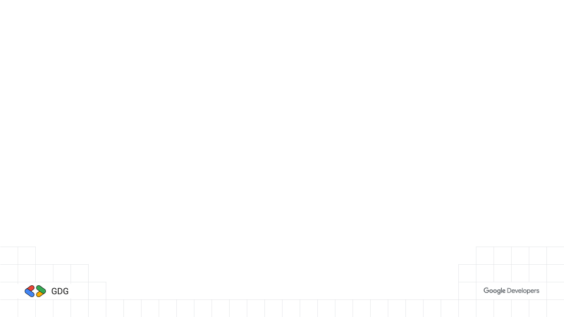
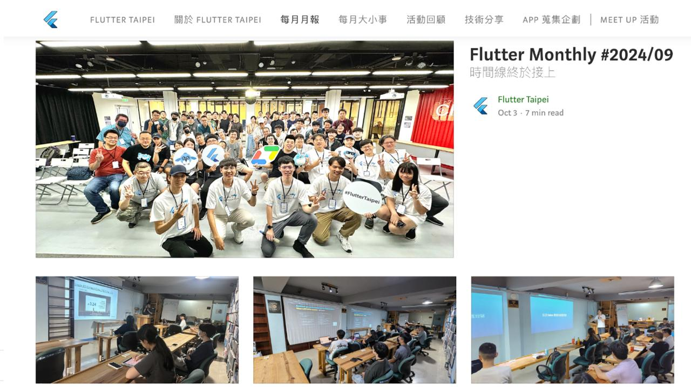
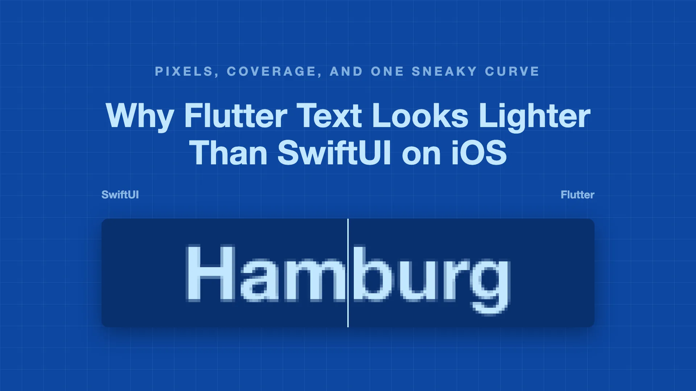

<style>
/* GDG brand — https://developers.google.com/community/gdg/brand-guidelines
   選擇器一律帶 section 前綴：Marp 會補上與 default theme 同級的高特異性前綴，
   少了 section 就會被 theme 的 `section :is(h1)` 蓋掉。 */

section {
  --h1-color: #1e1e1e;
  --heading-strong-color: #4285f4;
  --paginate-color: #5f6368;
  background: #ffffff;
  color: #1e1e1e;
  font-family: "Google Sans", "Product Sans", Roboto, "Noto Sans TC",
    "PingFang TC", "Microsoft JhengHei", sans-serif;
  font-size: 26px;
  line-height: 1.65;
  padding: 64px 72px;
}

section h1 {
  font-size: 52px;
  font-weight: 700;
  letter-spacing: -0.01em;
  margin-bottom: 28px;
  padding-bottom: 20px;
  background-image: linear-gradient(
    to right,
    #4285f4 0 25%, #ea4335 25% 50%, #f9ab00 50% 75%, #34a853 75% 100%
  );
  background-repeat: no-repeat;
  background-size: 200px 6px;
  background-position: left bottom;
}

section h2 { font-size: 34px; font-weight: 500; color: #4285f4; }
section h3 { font-size: 28px; font-weight: 400; color: #5f6368; }

section code {
  font-family: "Google Sans Mono", "Roboto Mono", "SF Mono", monospace;
  background: #f0f0f0;
  color: #1e1e1e;
  padding: 2px 8px;
  border-radius: 4px;
  font-size: 0.88em;
}
section a { color: #4285f4; text-underline-offset: 3px; }

section ul > li::marker { color: #4285f4; }
section ul ul > li::marker { color: #34a853; }
section ul ul { font-size: 0.92em; color: #3c4043; }
section li { margin: 0.3em 0; }

section blockquote {
  border-left: 5px solid #f9ab00;
  background: #fffdf5;
  margin: 20px 0;
  padding: 12px 22px;
  color: #1e1e1e;
  font-style: normal;
}

/* 封面：疊在 cover-v2.png 上，不要四色底線 */
section.cover h1 {
  background-image: none;
  padding-bottom: 0;
  font-size: 76px;
  margin-top: 120px;
}

/* 段落分隔頁：GDG 藍底 */
section.divider {
  --h1-color: #ffffff;
  --paginate-color: rgba(255, 255, 255, 0.8);
  background: #4285f4;
  color: #ffffff;
}
section.divider h1 {
  font-size: 64px;
  background-image: linear-gradient(
    to right,
    #ffffff 0 25%, #f9ab00 25% 50%, #c3ecf6 50% 75%, #34a853 75% 100%
  );
}
section.divider h2 { color: #ffffff; opacity: 0.92; }
</style>

<!-- _class: cover -->

# Flutter 小聚 #39

### 2026 / 10 ・ GDG Taipei × Flutter Taipei



---

# 小聚說明

- 主辦社群: **GDG Taipei**、**Flutter Taipei**
- 原則上一個月會舉辦一次，時間會在當月**最後一週的週二**
- 地點：**天瓏書局 2F**
- 活動主要會分成
  - 當月 Flutter 大小事: 介紹當月 Flutter 相關的大小事
  - 開發者經驗分享: 分享與 Flutter 開發的相關內容，題目不限，可洽志工報名
  - Lightning Talk: 現場/活動事前表單報名，在場有任何想法，可洽志工報名
  - 活動任何問題都可以透過 **Slido** 發問
- 小聚任何行為都參照 GDG 台灣 行為準則 https://gdg.tw/code_of_conduct/

---


---


---

# Flutter Taipei 每月月報



---

# 上台分享可獲得一個 Pin 針 及 帽子


---


# 近期社群活動｜GDG Taipei

- **GDG 2026 / 10 月會**
  - 因天氣從 10/23 **延到 10/27** [活動頁](https://gdg.community.dev/events/details/google-gdg-taipei-presents-gdg-2026-10-yue-hui-yin-wei-tian-qi-yin-su-wo-men-cong-1023-yan-dao-1027/)
- **DevFest Taipei 2026**
  - 12/13（日）台大博雅館 [活動頁](https://gdg.community.dev/events/details/google-gdg-taipei-presents-devfest-taipei-2026/cohost-gdg-taipei)｜[徵講者](https://sessionize.com/devfest-taipei-20261213)
- 近期已辦
  - GDG 2026 / 09 月會：**WebMCP**（9/17）

---

# [Slido](https://qr.sli.do/eQTCNA2MbBkHf2QniNniHc)


---

<!-- _class: divider -->

# Flutter 十月大小事

## Rainer Fang

---

# 十月重點一覽

- **3.47.8** 安全性更新：Android / Windows / Linux **要重 build**
- **3.50 beta**：Android Intent 驗證變嚴格
- **Genkit Dart 1.0** 正式版
- 官方：AI 讓遷移變容易，**Flutter 讓規模化變容易**
- 為什麼 Flutter 字看起來**比 SwiftUI 細**

---

# Flutter 3.47 hotfix

| 版本 | 重點修正 |
|---|---|
| 3.47.6 | **Windows release app 卡死** |
| 3.47.7 | iOS VoiceOver 焦點錯位（`OverlayPortal`、`ReorderableListView`） |
| 3.47.8 | **安全性更新**：BoringSSL 封鎖 eMudhra 中繼 CA、Android 14+ 改用系統 root 憑證 |

> 要 ship Android、Windows、Linux，**升到 3.47.8 並重新 build**。

- 來源：[CHANGELOG](https://github.com/flutter/flutter/blob/master/CHANGELOG.md)｜[GHSA-frr6-h895-5pxp](https://github.com/dart-lang/sdk/security/advisories/GHSA-frr6-h895-5pxp)

---

# Flutter 3.50 beta

> 10/14 `3.50.0-0.1.pre`、10/23 `0.2.pre`，Dart **3.14**

- Android：**Intent 驗證變嚴格**、release 模式**忽略 engine flags**
- Web：`viewport-fit=cover` 生效，`SafeArea` 讀得到瀏海
  - 已經加了這個設定的專案，**畫面會變滿版**
- `DropdownButton` 新增 `enabled`
- `material_ui` / `cupertino_ui` 遷移指南

- 來源：[Breaking changes](https://docs.flutter.dev/release/breaking-changes#not-yet-released-to-stable)

---

# Android Intent 驗證變嚴格

- release 模式下，**外部 Intent** 帶的這些 extras 會被忽略
  - `route`、`dart_entrypoint`、`dart_entrypoint_args`
  - `cached_engine_id`、`cached_engine_group_id`
- 防止外部 app **跳到內部頁面**、**重用已登入的 engine**
- 推播、捷徑用 `route` 開頁的，**要改成 deep link**

```xml
<activity android:name=".MyFlutterActivity" android:exported="false" />
```

- 來源：[遷移指南](https://docs.flutter.dev/release/breaking-changes/stricter-android-entrypoint-intent-verification)

---

# Genkit Dart 1.0


> 10/8 正式版

- 一套 API 切換 **Gemini、Claude、OpenAI**
- `schemantic`：schema 寫一次，**前後端共用型別**
- tool 可 **interrupt**，等使用者確認再繼續
- 實驗性：stateful agent、**A2UI** 串流原生 UI

```bash
dart pub add genkit
```

- 來源：[Dart blog](https://dart.dev/blog/announcing-genkit-dart-1-0)｜[Flutter blog](https://flutter.dev/blog/announcing-genkit-dart-1-0)

---

# AI 好遷移，Flutter 好擴展


> 10/20 官方 blog

- 「AI 寫兩套 native 就好？」→ 需求**分岔成兩份**維護
- 兩個 agent 各寫一套，**行為會各自漂移**
- 瓶頸是**驗證**，不是產生程式碼
- hot reload < 200ms vs native build 2～5 分鐘

- 來源：[Flutter blog](https://flutter.dev/blog/ai-makes-it-easy-to-migrate-flutter-makes-it-easy-to-scale)

---

# Flutter 字為何比 SwiftUI 細



- Skia 的 **gamma / contrast 表**削掉反鋸齒邊緣
- 沒吃 SF Pro 的 **tracking 表**，字距偏寬
- 補救：同色、75% 不透明的 `Shadow` **再畫一次**
- 官方 issue [#120857](https://github.com/flutter/flutter/issues/120857) 仍 open（P2）

- 來源：[birju.dev](https://birju.dev/posts/looking-into-flutter-vs-swiftui-font-rendering/)

---

# iPhone Duo 後續

> 10/23 已出貨

- `displayFeatures` 在 iOS 上**仍然是空的**
- 提案 [#192515](https://github.com/flutter/flutter/issues/192515) 還是 **P2**、尚未合併
- 摺疊狀態先用 [`foldable`](https://pub.dev/packages/foldable)

---

# 社群熱議：工具

- **Raccoon**：建在 C embedder API 的小型 runtime
  - 不用 Xcode / Gradle，**15 秒**跑起整個 app，支援 hot reload
- **flutter_shim**：Flutter web 在 120Hz Android 被 Chrome **鎖 60fps**
  - canvas 交給 web worker，實測 57 → **113–120fps**
- **avdslim**：Android emulator 記憶體 **8GB → 1.5GB**

- 來源：[r/FlutterDev 本月熱門](https://www.reddit.com/r/FlutterDev/top/?t=month)

---

# 社群熱議：經驗分享

- 用 `analysis_server_plugin` 寫**自家 lint**，不需要 `custom_lint`
- **訂閱被破解**：patch 改掉 RevenueCat entitlement 檢查
  - 舊版 SDK 帶 `-dontoptimize` 關掉 R8，升級後 patch 暫時失效
- **效能調校**：`flutter_svg` 在 Impeller 用 raster 較快；cache extent 調 0
- **Riverpod 為什麼離開 widget tree**：`InheritedElement` 不會取消註冊 dependency

- 來源：[r/FlutterDev 本月熱門](https://www.reddit.com/r/FlutterDev/top/?t=month)

---

# 這個月該做的事

1. 升到 **3.47.8**，Android / Windows / Linux 重 build
2. 檢查有沒有用 Intent extras 帶 `route`
3. Web 專案確認 `viewport-fit` 設定
4. 還沒 target **API 36** 的，延長期限 **11/1** 到期

---

# Q & A


