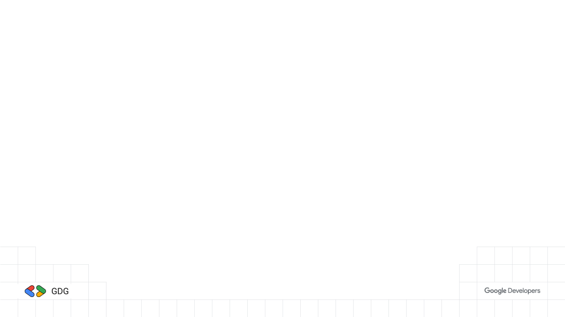
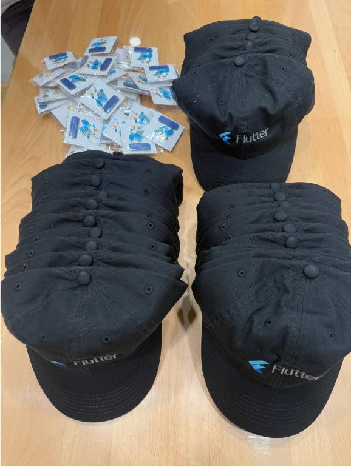
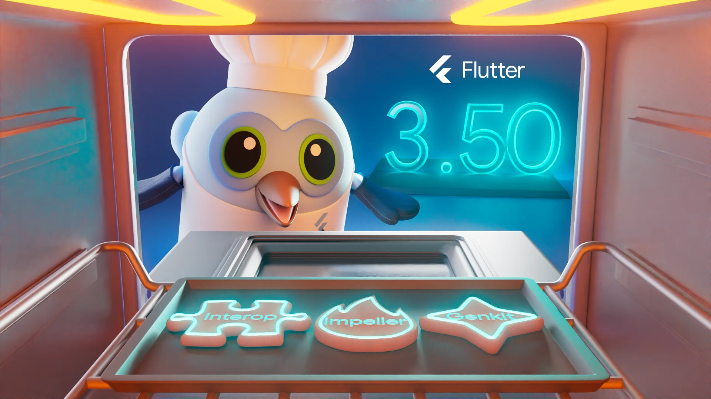
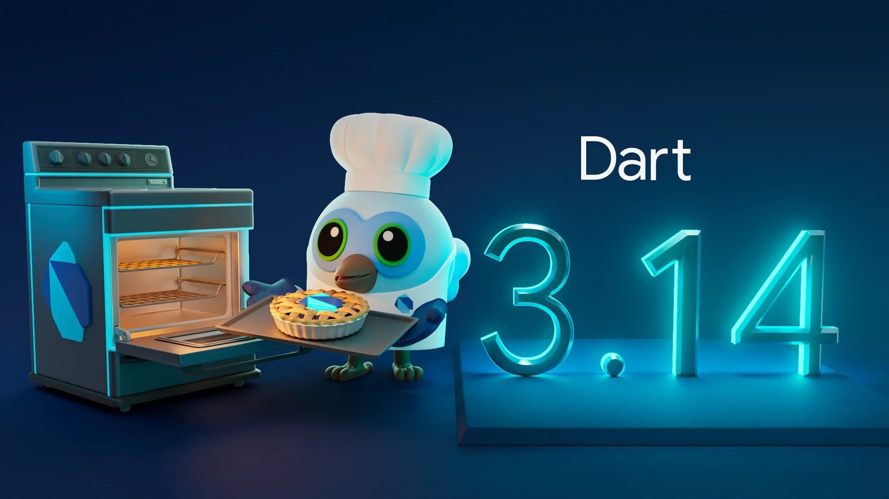
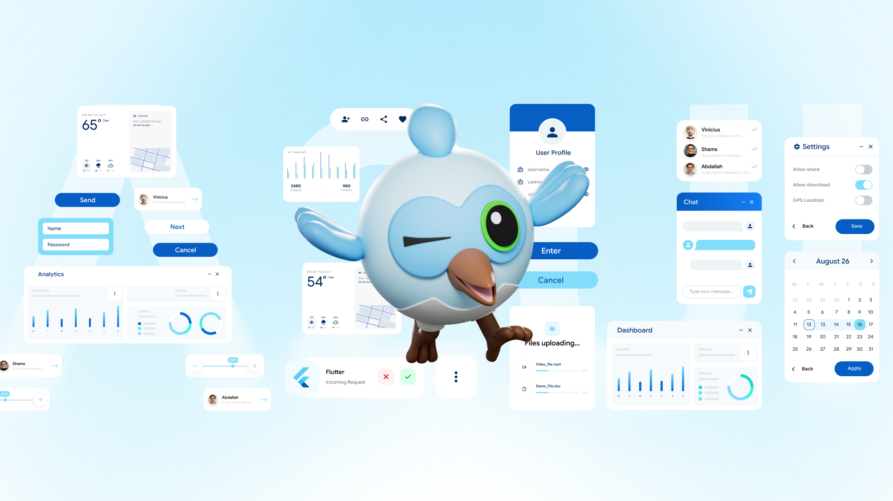

<style>
/* GDG brand — https://developers.google.com/community/gdg/brand-guidelines
   選擇器一律帶 section 前綴：Marp 會補上與 default theme 同級的高特異性前綴，
   少了 section 就會被 theme 的 `section :is(h1)` 蓋掉。 */

section {
  --h1-color: #1e1e1e;
  --heading-strong-color: #4285f4;
  --paginate-color: #5f6368;
  background: #ffffff;
  color: #1e1e1e;
  font-family: "Google Sans", "Product Sans", Roboto, "Noto Sans TC",
    "PingFang TC", "Microsoft JhengHei", sans-serif;
  font-size: 26px;
  line-height: 1.65;
  padding: 64px 72px;
}

section h1 {
  font-size: 52px;
  font-weight: 700;
  letter-spacing: -0.01em;
  margin-bottom: 28px;
  padding-bottom: 20px;
  background-image: linear-gradient(
    to right,
    #4285f4 0 25%, #ea4335 25% 50%, #f9ab00 50% 75%, #34a853 75% 100%
  );
  background-repeat: no-repeat;
  background-size: 200px 6px;
  background-position: left bottom;
}

section h2 { font-size: 34px; font-weight: 500; color: #4285f4; }
section h3 { font-size: 28px; font-weight: 400; color: #5f6368; }

section code {
  font-family: "Google Sans Mono", "Roboto Mono", "SF Mono", monospace;
  background: #f0f0f0;
  color: #1e1e1e;
  padding: 2px 8px;
  border-radius: 4px;
  font-size: 0.88em;
}
section a { color: #4285f4; text-underline-offset: 3px; }

section ul > li::marker { color: #4285f4; }
section ul ul > li::marker { color: #34a853; }
section ul ul { font-size: 0.92em; color: #3c4043; }
section li { margin: 0.3em 0; }

section blockquote {
  border-left: 5px solid #f9ab00;
  background: #fffdf5;
  margin: 20px 0;
  padding: 12px 22px;
  color: #1e1e1e;
  font-style: normal;
}

/* 封面：疊在 cover-v2.png 上，不要四色底線 */
section.cover h1 {
  background-image: none;
  padding-bottom: 0;
  font-size: 76px;
  margin-top: 120px;
}

/* 段落分隔頁：GDG 藍底 */
section.divider {
  --h1-color: #ffffff;
  --paginate-color: rgba(255, 255, 255, 0.8);
  background: #4285f4;
  color: #ffffff;
}
section.divider h1 {
  font-size: 64px;
  background-image: linear-gradient(
    to right,
    #ffffff 0 25%, #f9ab00 25% 50%, #c3ecf6 50% 75%, #34a853 75% 100%
  );
}
section.divider h2 { color: #ffffff; opacity: 0.92; }
</style>


<!-- _class: cover -->

# Flutter 小聚 #40

### 2026 / 11 ・ GDG Taipei × Flutter Taipei



---

# 小聚說明

- 主辦社群: **GDG Taipei**、**Flutter Taipei**
- 原則上一個月會舉辦一次，時間會在當月**最後一週的週二**
- 地點：**天瓏書局 2F**
- 活動主要會分成
  - 當月 Flutter 大小事: 介紹當月 Flutter 相關的大小事
  - 開發者經驗分享: 分享與 Flutter 開發的相關內容，題目不限，可洽志工報名
  - Lightning Talk: 現場/活動事前表單報名，在場有任何想法，可洽志工報名
  - 活動任何問題都可以透過 **Slido** 發問
- 小聚任何行為都參照 GDG 台灣 行為準則 https://gdg.tw/code_of_conduct/

---


---


---

# 上台分享可獲得一個 Pin 針 及 帽子



---

# 今晚議程

| 時間 | 內容 |
|---|---|
| 19:35 | Flutter 十一月大小事 ｜ Rainer Fang |
| 20:05 | **Flutter GenUI × Gemini: Let Your Agent Answer With a Screen** ｜ Yii Chen |

- 活動頁：[Flutter 小聚 #40](https://gdg.community.dev/events/details/google-gdg-taipei-presents-flutter-meetup-40/)

---

# 近期社群活動｜GDG Taipei

- **DevFest Taipei 2026**
  - 12/13（日）台大博雅教學館，免費報名 [活動頁](https://gdg.community.dev/e/mp6c72/)｜[官網](https://devfest-taipei.gdg.tw/2026/)
  - 議程已公布：DeepMind AI Audio、CodeMender、Antigravity CLI…
- 近期已辦
  - GDG × GDG Cloud Taipei 11 月聯合月會：**迎戰 Agentic Era**（11/19）
  - GDG 2026 / 10 月會（10/27）

---

# [Slido](https://qr.sli.do/cZWMN53BfioPthU4mxUEs2)


---

<!-- _class: divider -->

# Flutter 十一月大小事

## Rainer Fang

---

# 十一月重點一覽

- **Flutter 3.50 / Dart 3.14** stable（11/11）
- `material.dart` / `cupertino.dart` **正式 deprecated**
- **Direct native interop** 進 stable：FFIgen、JNIgen
- **A2UI 1.0**，`genui` 改名 `a2ui_flutter`
- CocoaPods trunk **12/2 起唯讀**

---

# Flutter 3.50



> 11/11 釋出，188 位貢獻者、1,200+ commits

- iOS 觸控延遲**少一個 frame**（120Hz 快 8ms）
- Web：Safari / Firefox 跑 Wasm **2 倍以上 frame rate**
- Web：WebParagraph preview，CanvasKit **5.46 → 3.75 MB**
- 新 flag `--web-content-hash` 處理 cache busting
- Flutter **RFC 流程**上線

- 來源：[What's new in Flutter 3.50](https://flutter.dev/blog/whats-new-in-flutter-3-50)

---

# Material / Cupertino 解耦

- `package:flutter/material.dart`、`cupertino.dart` **deprecated**
- `flutter create` 預設改 import **`material_ui`**
- 一行指令遷移

```bash
dart fix --apply --code=migrate_design_widgets
```

- `material_ui` 已到 **1.11.1**、`cupertino_ui` **1.1.7**

- 來源：[遷移指南](https://docs.flutter.dev/release/breaking-changes)

---

# 3.50 Android 預設值

- 新專案：**AGP 9.3.1**、Gradle 9.5.0、KGP 2.4.20、**Java 17+**
- compileSdk / targetSdk **36**、minSdk **24**
- 還**手動套用 KGP** 的 plugin
  - pub.dev 分數會降，**AGP 10 會 build 不過**
- HCPP 改進：API 34+ 加 Vulkan，beta 已預設開啟

---

# Hotfix

| 版本 | 重點修正 |
|---|---|
| 3.47.9 | Windows `MAX_PATH` crash、monorepo `flutter test` native assets 錯誤 |
| 3.50.1 | **`.env` 等點開頭 asset 被默默排除**（Android） |
| 3.50.1 | `--split-per-abi` 的 `versionCode` 全部一樣 |
| 3.50.1 | 不加 `--web-content-hash` 重 build 會**刪掉 `index.html`** |
| Dart 3.14.1 | pattern `switch` + closure capture 的 AOT crash |

> 已經升 3.50 的，**直接上 3.50.1**。

- 來源：[CHANGELOG](https://github.com/flutter/flutter/blob/master/CHANGELOG.md)

---

# Native interop 進 stable


> 11/12 官方 blog

- **FFIgen**（C / ObjC）、**JNIgen**（Java / Kotlin）stable
- 不經 platform channel：**同步呼叫**、可從 background isolate 呼叫
- **Pigeon 30** native interop mode preview（Windows / Linux 仍走 channel）
- `shared_preferences` 已遷移

- 來源：[Flutter blog](https://flutter.dev/blog/stable-native-interop)

---

# Dart 3.14



- 新指令 **`dart migrate`**：一次升一個 minor
  - prepare → bump → cleanup，支援 `--dry-run`
- pub 支援 **ETag**，沒變動回 304
- **DartPad 重寫**（beta）：compiler、analyzer 編成 Wasm 本地跑
  - 完整 LSP、多檔案、任何 pub.dev 套件
- Wasm：128-bit **SIMD**，最高快 4 倍

- 來源：[Announcing Dart 3.14](https://dart.dev/blog/announcing-dart-3-14)

---

# A2UI 1.0 與 a2ui_flutter



> 11/17，接下來 Yii Chen 的主題

- `genui` 改名 **`a2ui_flutter`**
- `allowedParents` / `allowedChildren` **guardrail**
- Express format：比 JSON **少 46% 字元**
- `callAgentFunction`：widget 直接呼叫後端，**不經 LLM**
- 1.0 是**協定版本**，套件仍是 **0.5.0**

- 來源：[Flutter blog](https://flutter.dev/blog/a2ui-launch)

---

# 生態系更新

- **Riverpod 3.5**：dispose 時 `provider.future` 改丟 `ProviderDisposedException`
- **Serverpod 4.1**
  - `serverpod runner`：每個 worktree 各自的 server + DB
  - `Model.db.watch` reactive ORM、OTP 登入
- **FlutterFire**：`firebase_core` 5.2.0 修 3.50 下的 App Check 問題
- **DevTools 2.62**：移除舊 Provider 畫面

---

# CocoaPods trunk 12/2 起唯讀

- **不能再發新版 pod**，Firebase 已停發 CocoaPods
- 3.50 對**關閉 SPM** 的專案每個指令都會警告
- 還在用 CocoaPods 的 plugin，**該換 SPM 了**

```bash
flutter config --enable-swift-package-manager
```

- 來源：[CocoaPods blog](https://blog.cocoapods.org)｜[Google Ads blog](https://developers.google.com/ads/blog/posts/2026/11/prepare-for-cocoapods-read-only-mode)

---

# 社群套件

- **liquidum**：純 Flutter 重刻 iOS 26 **Liquid Glass**
  - 不用 platform view，走 `ImageFilter.shader`，需要 Impeller
- **nativeapi_flutter**：一份 C++ core 統一 window、tray、menu
- **shorebird_ci**：monorepo 只跑**受影響的 package**
- **pqcrypto**：純 Dart **後量子密碼學**（ML-KEM、ML-DSA）

- 來源：[liquidum](https://pub.dev/packages/liquidum)｜[nativeapi_flutter](https://pub.dev/packages/nativeapi_flutter)｜[shorebird_ci](https://pub.dev/packages/shorebird_ci)｜[pqcrypto](https://pub.dev/packages/pqcrypto)

---

# 下一版預告：3.51 beta

> 11/11 `3.51.0-0.1.pre`，Dart **3.15** beta

- `this` 可以做 **type promotion**

```dart
if (this is Circle) print(radius);
```

- control flow join 後保留更多 promotion
- 新 lint：`unnecessary_this_alias`

---

# 這個月該做的事

1. 升到 **3.50.1**，跑 `migrate_design_widgets`
2. Android 檢查 **點開頭 asset**、split APK `versionCode`
3. iOS 開啟 **SPM**，12/2 前搬離 CocoaPods
4. 填 [Flutter Q4 問卷](https://flutter.dev/blog/flutter-q4-2026-survey)，**12/2 截止**

---

# Q & A


